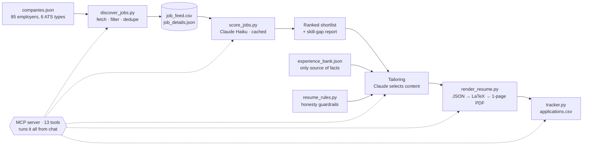

# Job-Search Copilot

A human-in-the-loop Python tool that finds the right ~40 analyst roles instead of blasting 400 applications, then tailors a truthful one-page resume for each one.

It pulls live postings from 85 employers' public hiring APIs, ranks them with an LLM, and builds a resume PDF using **only** facts from a verified experience bank. It never submits anything: a person reviews every resume and clicks submit.

**Stack:** Python 3.12 · REST/JSON APIs · Claude API (Haiku + Sonnet) · MCP server · LaTeX (Tectonic) · `httpx` · `ThreadPoolExecutor`

<!--
## Demo
Screenshots go here in the next version:
- the ranked job feed
- a sample resume rendered from the fictional example bank
-->

---

## How it works



| Stage | What happens |
|---|---|
| **1. Discover** | Fetches postings from Workday, Oracle HCM, Greenhouse, Lever, Ashby and Amazon. Every fetcher returns the same normalized record (`title, location, url, date, description`), so nothing downstream cares which system a job came from. Filters by title keywords, location and posting age. |
| **2. Score** | Claude Haiku rates each job's fit 0–100 with a one-line reason, flags (`too_senior`, `not_analytics`, …) and up to five missing skills. Scores are cached by URL, so only new postings cost money. |
| **3. Tailor** | Claude picks and reorders bullets from the experience bank to match the posting. It returns structured JSON, not a document. |
| **4. Render** | Plain Python turns that JSON into LaTeX and compiles a PDF. If it spills onto page 2, the renderer trims the least relevant bullet and recompiles until it fits. |
| **5. Track** | Logs each application and keeps a reusable library of screening-question answers. |

All of it runs from a chat window through an **MCP server** in the Claude desktop app: *"refresh my feed" → "show my top 10" → "tailor my resume to row 3" → "log that I applied"*.

## Key results

- **85 employers across 6 applicant-tracking systems**, searched nationwide, using only their public job-board APIs.
- **Full refresh cut from 20+ minutes to about 1 minute** after the employer list doubled: companies are fetched in parallel (8 workers), paging stops once relevance-sorted results stop matching, and only server errors (5xx) are retried. A mock benchmark went from 142 s to 7 s with identical results.
- **AI ranking with caching:** hundreds of postings scored for a fraction of a cent each; clearly overseas jobs are filtered in code and never sent to the API.
- **13-tool MCP server** covering the feed, job descriptions, tailoring, rendering, skill gaps, screening answers and application tracking.

## Design decisions

1. **Human in the loop.** The tool never submits applications. It speeds up finding and tailoring; a person makes every decision.
2. **No invented facts.** The experience bank is the single source of truth. The model may select, reorder and lightly rephrase, but never add tools, numbers or experiences. The same rules file (`resume_rules.py`) guards both tailoring paths, so they can't drift apart.
3. **Content separate from layout.** The LLM only produces JSON content; deterministic code owns the layout, LaTeX escaping, file names and the one-page limit.
4. **Let the LLM judge fuzzy things; let code decide rules.** Skill fit is a judgment call, so the model scores it. Location is a rule, so code applies it after scoring. (The model was inconsistent about location, which is how this split came about.)
5. **Sanctioned APIs only.** Public ATS JSON endpoints, polite parallelism (one request stream per employer), no LinkedIn or Indeed scraping.
6. **Cheap model for bulk work, stronger model for writing.** Haiku scores hundreds of jobs; Sonnet (or Claude in the app) writes resumes.

## Project structure

| File | Purpose |
|---|---|
| `discover_jobs.py` | Stage 1: fetchers for 6 ATS types, filters, parallel fetch, retries, `--verify` health check |
| `descriptions.py` | Shared job-description lookup (saved copy first, live fetch for Workday/Oracle) |
| `us_location.py` | `is_non_us()` helper used by discovery and scoring |
| `score_jobs.py` | Stage 2: LLM fit scoring, caching, skill-gap report |
| `resume_rules.py` | Resume schema plus tailoring and screening-answer guardrails |
| `tailor_resume.py` | Stage 3 from the command line (Claude API) |
| `render_resume.py` | Stage 4: JSON → LaTeX → PDF with one-page auto-fit |
| `tracker.py` | Application log helpers |
| `job_copilot_server.py` | MCP server exposing the whole workflow as 13 tools |
| `add_companies.py` | Merges new employers into `companies.json` |
| `companies.json` | Target employers and their public careers-site identifiers |
| `experience_bank.example.json` | A **fictional** profile so anyone can run the project |

## Setup

Tested on macOS with Python 3.12.

```bash
git clone https://github.com/miguel-jaimes/job-search-copilot.git
cd job-search-copilot

pip install -r requirements.txt
conda install -c conda-forge tectonic        # LaTeX engine for the PDFs

cp .env.example .env                          # then add your Anthropic API key
cp experience_bank.example.json experience_bank.json   # then replace with your own facts
```

`.env` and `experience_bank.json` are in `.gitignore`, so your key and personal data stay on your machine.

## Usage

```bash
python discover_jobs.py --verify      # check every employer's endpoint (1 page each)
python discover_jobs.py --score       # full refresh + AI scores
python score_jobs.py --gaps           # most common missing skills in near-fit jobs
python tailor_resume.py job.txt --company "Acme"   # tailor to a pasted posting
python render_resume.py resumes/X.json             # re-render an edited resume
```

To use it from chat, add the server to the Claude desktop app's config (`~/Library/Application Support/Claude/claude_desktop_config.json`):

```json
{
  "mcpServers": {
    "job-copilot": {
      "command": "/path/to/python",
      "args": ["/path/to/job-search-copilot/job_copilot_server.py"]
    }
  }
}
```

## What I learned

- **Status codes tell you whose problem it is.** A 4xx means my request is wrong, so fail fast. A 5xx means their server hiccupped, so retry with backoff. Treating a 502 as "bad URL" was an early bug.
- **Normalize early.** Six different response formats become one record at the edge, which kept the filters, scoring and MCP tools simple.
- **Verify assumptions against real responses.** Workday only reports its result total on the first page, and Oracle returns non-JSON without a specific header. Neither showed up in documentation; both showed up in testing.
- **Scaling exposes design limits.** A sequential loop that was fine for 40 employers took 20+ minutes at 85. Parallelism plus stopping early fixed it.

## Limitations and next steps

- Employers on iCIMS, Eightfold, Taleo, SuccessFactors and Avature aren't supported yet; their email job alerts cover the gap.
- `companies.json` reflects one person's search (entry-level analyst roles, DFW-focused). Edit it for your own targets.
- The scorer reads candidate facts from `experience_bank.json`, but its prompt in `score_jobs.py` describes the candidate as a new-grad analytics student. Adjust that wording for other profiles.
- No automated tests yet. Next: `pytest` with `httpx.MockTransport` for the fetchers, filters, LaTeX escaping and auto-fit.
- Next: measure the AI scorer against ~30 hand-labeled jobs (precision in the top 10).

## License

MIT. See [LICENSE](LICENSE).

---

Built by **Miguel Jaimes**, B.S. Business Analytics, UT Dallas (Dec 2026) · [LinkedIn](https://www.linkedin.com/in/miguel-jaimes-7558a2133/)
