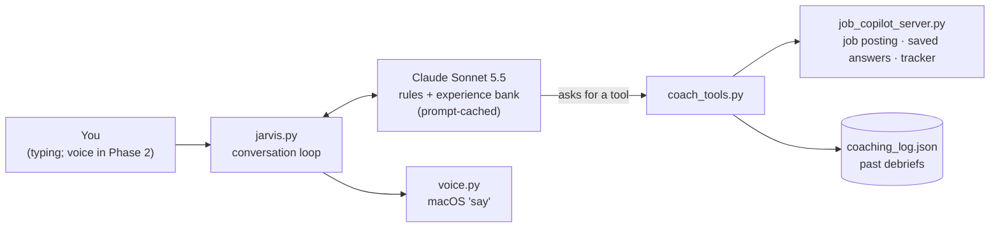

# Jarvis: a personal interview coach

A mock interviewer and speaking coach that runs on my Mac and knows my real experience. It plays the hiring manager for a specific job, using the posting my job copilot already saved. On request it switches to coaching me on an answer, then scores the session and remembers my weak spots for next time.

It's a **practice** tool. It never runs during a real interview.

## Setup

Nothing new to install. Jarvis uses the copilot's existing packages, `.env` API key and `experience_bank.json`.

1. Put the `jarvis` folder inside the project folder (`~/Job_App_Project/job-copilot-phase1/jarvis/`).
2. Replace the project's `.gitignore` with the updated one. It keeps practice transcripts and debriefs out of GitHub.

## Run it

From the project folder:

```bash
cd ~/Job_App_Project/job-copilot-phase1
python jarvis/jarvis.py                          # type answers, read replies
python jarvis/jarvis.py --speak                  # Jarvis also says its replies out loud
python jarvis/jarvis.py --speak --company Toyota # jump straight into a Toyota mock interview
```

Optional flags:

- `--voice "Samantha"` picks the voice. List the voices you have with `say -v '?'`.
- `--rate 170` sets the speaking speed in words per minute.
- `--model claude-haiku-5-5` uses the cheaper model.

**Better voices (free):** System Settings → Accessibility → Spoken Content → System voice → Manage Voices. Download an "Enhanced" or "Premium" voice, then pass its name to `--voice`.

## Talking to it

Just talk normally ("interview me for Toyota", "coach me on that", "how did I do?"), or use a shortcut:

| Shortcut | What it does |
|---|---|
| `/interview Toyota` | Mock interview built from that job's saved posting. Add a role after the company to narrow it down. |
| `/interview` | General analyst mock interview |
| `/coach` or `/pause` | Feedback on your last answer, plus a tightened version you could actually say |
| `/resume` | Back to the interview |
| `/debrief` | Scores (1–5), top fixes, a drill. Saved for next time. |
| `/quit` | Save the transcript and exit |

Sending a new message stops Jarvis talking. `Ctrl+C` while it's thinking cancels that turn.

## The four modes

| Mode | Jarvis acts as | What it does |
|---|---|---|
| Chat | Practice planner | Picks stories for a role, helps explain a project |
| Interview | The hiring manager | One question at a time, real follow-ups ("what did *you* do?", "why that tool?"), no feedback until you ask |
| Coach | Speaking coach | What worked, the biggest fix, a better story from the bank if one fits, then a ~60-second casual rewrite using only real facts |
| Debrief | Scorer | Structure, specificity, relevance, conciseness, project explanations; saves the results |

## How it works



| File | Job |
|---|---|
| `coach_prompts.py` | The rules: modes, how to interview, how to coach, how to score. Change Jarvis's behavior here, not in code. |
| `coach_tools.py` | The six tools Claude can call. Four are reused straight from the MCP server, so job postings and saved answers are read exactly one way. The other two are the coaching memory. |
| `voice.py` | Speaks replies in the background, after stripping markdown and mode tags. |
| `jarvis.py` | Reads input, streams Claude's reply, runs tools, tracks cost, saves the transcript. |

**Design decisions:**

1. **One brain, many modes.** The modes are rules in a prompt, not separate programs. Claude starts each reply with a tag like `[COACH]`, which the program reads to show the label. Typing `/coach` and saying "coach me" go through the same path.
2. **Same honesty rule as the resumes.** The experience bank is the only source of facts. If I say something that isn't in it, Jarvis flags it instead of polishing it.
3. **Reuse, don't copy.** The tools import the copilot's server functions instead of re-implementing them.
4. **Memory that targets weak spots.** Debriefs are saved as data (scores, fixes, questions asked). The next session checks which fixes keep repeating and aims questions there.
5. **Cheap by design.** The rules and experience bank are identical every turn, so they're prompt-cached. After the first turn that big block costs about 5% of the normal input price. Voice output is the Mac's free built-in speech.

## Cost

Each session prints its estimated cost at the end and in the saved transcript. A 30-minute mock on Sonnet should land around 10–40 cents. It's cheaper on `claude-haiku-5-5`, but the coaching is less sharp.

## Privacy

- `jarvis/sessions/` (transcripts) and `jarvis/coaching_log.json` (debriefs) stay on this Mac and are gitignored.
- What you type goes to the Claude API, the same as the rest of the copilot.

## Roadmap

- [x] **Phase 1:** text conversation, four modes, experience-bank grounding, tools reused from the copilot, coaching memory, spoken replies
- [ ] **Phase 2:** voice input. Push-to-talk speech-to-text that runs locally, sized for an Intel Mac.
- [ ] **Phase 3:** question bank by company and role, and progress over time (scores across sessions)
- [ ] **Phase 4:** Jarvis extras: daily job feed brief, applications needing follow-up
